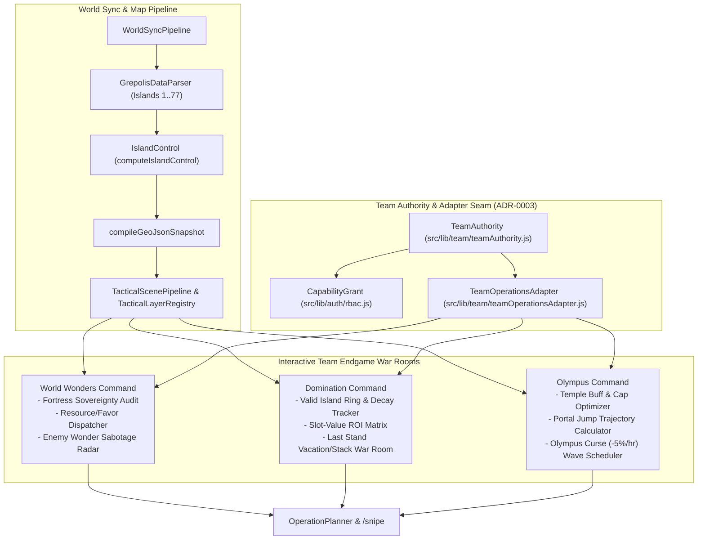

# Grepolis World Endgames — Interactive Team Strategy & Architecture Blueprint

> **Companion Reference**: See [grepolis_endgames_official_mechanics.md](file:///d:/Dev/Web/Grepolis/docs/grepolis_endgames_official_mechanics.md) for the primary-source InnoGames Knowledge Base rules, mathematical formulas, tables, and official CDN visual assets for **World Wonders (`A világ csodái`)**, **Domination (`Dominancia`)**, and **Olympus (`Olimposz`)**.
>
> **Domain & Seam Alignment**: Designed to extend the canonical seams defined in [GLOSSARY.md](file:///d:/Dev/Web/Grepolis/GLOSSARY.md) and [ADR-0003](file:///d:/Dev/Web/Grepolis/docs/adr/0003-consolidate-team-administration-and-authority-seams.md) (`TeamAuthority`, `CapabilityGrant`, `TeamOperationsAdapter`, `TacticalScenePipeline`, `TacticalLayerRegistry`, `OperationPlanner`, `IslandControl`, `WorldSyncPipeline`, `TownIntelState`).

---

## 1. Executive Summary: Why Endgames Need Deep Team Tooling

In Grepolis, an alliance's transition from mid-game territorial expansion to the world endgame fundamentally shifts how players coordinate:

| Endgame Mode | Primary Strategic Bottleneck | Core Team Coordination Failure in Vanilla Grepolis |
| :--- | :--- | :--- |
| **World Wonders (`A világ csodái`)** | **Island Sovereignty & Resource/Favor Throughput**: 100% control of 20-slot large islands (`type ∈ [1..10, 37..46]`), 72h alliance-join cooldowns, tens of millions of resources per stage, 400-favor accelerations, and zero-tolerance defense against a single town loss or enemy foundation on an empty slot. | Spreadsheets go stale within minutes; leaders cannot easily see which Wonder island has an uncolonized foundation slot, which member has idle Market capacity within 2 hours of a Wonder, or which enemy Wonder island has a weak/inactive player (`intelRadar`) with a low wall (`TownIntelState`). |
| **Domination (`Dominancia`)** | **Slot-Efficiency on Valid Islands & Last Stand Defense**: Only towns on designated **Valid Islands** (`Érvényes szigetek`, large 20-slot islands in central oceans) count toward the 40% (and decaying) Domination threshold. During **Last Stand (`Végső kiállás`)**, Vacation Mode does **not** protect towns on Valid Islands. | Alliances waste Culture Slots conquering non-valid small islands (`type ∈ [11..16, 47..60]`) or outer-rim islands. During Last Stand, leaders lack an automated audit of which Valid Island towns belong to players on Vacation Mode (who are suddenly attackable!) or lack Bireme stacks. |
| **Olympus (`Olimposz`)** | **Temple Cap Optimization, Portal Routing & Olympus Curse (`-5%/hr`)**: Alliances hold capped numbers of Small/Large Temples for god buffs, route Colony Ships through **Portal Temples (`Portál templomok`)**, and battle the **Olympus Curse (`Olimposz átka`)** which destroys **5% of stationed defending troops every hour**. | Standard travel-time calculators cannot compute 2-leg **City → Portal Temple → Olympus** transit times. Static defense stacks on Olympus melt away from the `-5%/hr` curse before enemy strikes arrive unless reinforcements are scheduled in rotating waves. |

This blueprint specifies the **data model extensions**, **map pipeline upgrades**, **RBAC capability grants**, and **9 highly interactive Team War Room modules** (3 per endgame) that turn the project's existing **Team (`Team`)** system into an endgame command center.

---

## 2. Hidden Endgame Assets & Gaps Already in the Codebase

During our audit of the repository's map and ingestion engine, we uncovered major built-in assets alongside a critical parser gap:

### 2.1 Island Type Taxonomy in `island_definitions.json`
Inspection of [island_definitions.json](file:///d:/Dev/Web/Grepolis/src/lib/map/island_definitions.json) and [map_tile_renderer.js](file:///d:/Dev/Web/Grepolis/src/lib/map/js/map_tile_renderer.js) reveals all 77 Grepolis island/structure types (`island.type`):

1. **Large Colonizable Islands (`type ∈ [1..10, 37..46]`)**:
   - Render sprites `island1.png` .. `island20.png`.
   - Always have **20 town slots**, **farming villages**, resource modifiers (`resourcePlus`, `resourceMinus`), and a **World Wonder construction site (`wbg`)**.
   - [extracted_slots_from_html.json](file:///d:/Dev/Web/Grepolis/src/lib/map/extracted_slots_from_html.json#L4630-L4713) already contains the exact relative pixel coordinates (`tp: "wonder"`, `relX`, `relY`) for Wonder spots on large islands.
   - In **Domination** worlds, **only** islands from this large-island class within the central ocean ring are selected as **Valid Islands** (`DOMINATION_AREA_MARKER`).
2. **Small Colonizable Islands (`type ∈ [11..16, 47..60]`)**:
   - Render sprites `uninhabited1.png` .. `uninhabited20.png`.
   - Have **6–13 town slots**, no farming villages, **no World Wonder site**, and are **never Valid Islands** in Domination.
3. **Decorative Rocks (`type ∈ [17..36]`)**:
   - Render sprites `rock1.png` .. `rock20.png` (0 town slots).
4. **Olympus Temples (`type ∈ [61..77]`) — Already in `island_definitions.json`!**:
   - `61..66`, `74..75`: Small Temples (`small_temple_artemis`, `small_temple_athena`, `small_temple_hades`, `small_temple_hera`, `small_temple_poseidon`, `small_temple_zeus`, `small_temple_ares`, `small_temple_aphrodite`). Their `town_offsets` keys (`"1000"`..`"1358"`, `"1011"` = Portal Temple) map directly to the temple's `offset` (`number_on_island`) in `towns.txt`!
   - `67..72`, `76..77`: Large Temples (`large_temple_artemis`, `large_temple_athena`, `large_temple_hades`, `large_temple_hera`, `large_temple_poseidon`, `large_temple_zeus`, `large_temple_ares`, `large_temple_aphrodite`) with `town_offsets` keys `"2000"`..`"2275"`.
   - `73`: Mount Olympus (`olympus_temple`).

### 2.2 Critical Ingestion & GeoJSON Bug to Fix for Olympus Worlds
In [GrepolisDataParser.js](file:///d:/Dev/Web/Grepolis/src/lib/world/GrepolisDataParser.js#L26-L52):
```javascript
if (availableTowns === 0 && !populatedCoords.has(`${x},${y}`)) {
    continue;
}
```
And in [geojson.js](file:///d:/Dev/Web/Grepolis/src/lib/geojson.js#L71-L78):
```javascript
const isColonizable = (island.type >= 1 && island.type <= 16) || (island.type >= 37 && island.type <= 60);
```
Because `island.type` `61..77` (Small Temples, Large Temples, and Olympus) falls outside `1..16` and `37..60`, [compileGeoJsonSnapshot](file:///d:/Dev/Web/Grepolis/src/lib/geojson.js#L50-L150) currently misclassifies every Olympus Temple as an uninhabited rock (`availableTowns = 0`) and fails to project temple markers! Extending `GrepolisDataParser` and `geojson.js` to recognize `isTempleIsland(type) = type >= 61 && type <= 77` unlocks full Olympus temple rendering from existing public world data.

---

## 3. Core Architecture: Endgame Engine & Team Authority Seams



### 3.1 Prisma Schema Extensions (`prisma/schema.prisma`)

To support all three endgames across public world data and private Team coordination, we extend [schema.prisma](file:///d:/Dev/Web/Grepolis/prisma/schema.prisma):

```prisma
enum EndgameType {
  NONE
  WORLD_WONDERS
  DOMINATION
  OLYMPUS
}

enum EndgamePhase {
  PRE_ERA            // Before Wonder Era / Before Domination Era / Pre-Temple Phase
  SMALL_TEMPLES      // Olympus Phase 2
  LARGE_TEMPLES      // Olympus Phase 3
  ACTIVE_ERA         // Wonder Construction Era / Domination Active / Olympus Spawned
  LAST_STAND         // Domination Last Stand (7-14 days) / Olympus Held Countdown
  PEACE_COUNTDOWN    // 14-day endgame peace before world closure
  CLOSED
}

enum WonderType {
  PYRAMID            // Great Pyramid of Giza (+1,500 warehouse capacity)
  GARDENS            // Hanging Gardens of Babylon (+3% resource production)
  STATUE             // Statue of Zeus at Olympia (+5% favor production with Zeus)
  TEMPLE             // Temple of Artemis at Ephesus (+5% favor production with all gods)
  MAUSOLEUM          // Mausoleum at Halicarnassus (-5% mythological unit resource cost)
  COLOSSUS           // Colossus of Rhodes (-10% Victory Procession duration)
  LIGHTHOUSE         // Lighthouse of Alexandria (-5% Phoenician Merchant trade cost)
}
```

1. **Extend `World` ([schema.prisma](file:///d:/Dev/Web/Grepolis/prisma/schema.prisma#L11-L26))**:
   - `endgameType EndgameType @default(NONE)`
   - `endgamePhase EndgamePhase @default(PRE_ERA)`
   - `worldStartedAt DateTime?`
   - `eraStartedAt DateTime?`
   - `lastStandStartedAt DateTime?`
   - `lastStandAllianceId Int?`
   - `dominationTargetPct Float @default(40.0)`
2. **New `TeamWonderProject` Model (World Wonders)**:
   - Tracks both **Allied Wonder Islands** and **Enemy Tracked Wonders** per `Team`:
   - `id`, `teamId`, `worldId`, `islandId`, `wonderType` (`WonderType`), `allianceId`, `currentStage` (`0..10`), `isUnderExpansion` (`Boolean`), `stageResourcesWood`, `stageResourcesStone`, `stageResourcesIron`, `favorAccelerationsCount`, `estimatedCompletionAt`.
   - Child `TeamWonderContribution`: logs member resource shipments (`wood`, `stone`, `iron`, `arrivesAt`) and 400-favor casts (`castAt`, `god`).
3. **New `DominationValidIsland` & `TeamMemberStatus` Models (Domination)**:
   - `DominationValidIsland`: flags which large islands (`islandId`, `worldId`) belong to the official Domination Valid Island ring (`isValidDominationIsland: Boolean`, auto-computed from the central ocean ring + manual override by Team Strategists).
   - `TeamMemberStatus`: tracks `vacationModeActive: Boolean`, `vacationStartsAt: DateTime?`, `joinedAllianceAt: DateTime?` (critical for both the **72-hour Wonder contribution lock** and **Domination Last Stand vacation vulnerability**).
4. **New `OlympusTempleState` Model (Olympus)**:
   - `id`, `worldId`, `islandId`, `templeTownId`, `templeCategory` (`SMALL` | `LARGE` | `PORTAL` | `OLYMPUS`), `god` (`ZEUS` | `POSEIDON` | `HERA` | `ATHENA` | `HADES` | `ARTEMIS` | `APHRODITE` | `ARES`), `buffCode`, `buffValuePct`, `portalTargetOcean`, `ownerAllianceId`, `shieldEndsAt`, `nextJumpAt`, `npcDefenseJson`.

### 3.2 New RBAC Capability Grants (`src/lib/auth/rbac.js`)

Building on [rbac.js](file:///d:/Dev/Web/Grepolis/src/lib/auth/rbac.js#L13-L69) and [TeamAuthority](file:///d:/Dev/Web/Grepolis/src/lib/team/teamAuthority.js), we add two granular endgame permissions and three pre-configured role templates in [CustomRoleModal.js](file:///d:/Dev/Web/Grepolis/src/components/team/modals/CustomRoleModal.js):

- `ENDGAME_STRATEGIST` (`"Végjáték Stratéga"`):
  - Designate Allied/Enemy Wonder islands, configure Valid Island rings, assign Temple conquest priorities, trigger Last Stand defense allocations, and update world era timers.
- `WONDER_QUARTERMASTER` (`"Csoda Kormányzó / Logisztikus"`):
  - Manage Wonder resource quotas, log/verify member resource shipments, coordinate 400-favor acceleration casts, and audit 72h alliance-join cooldowns.

---

## 4. Mode 1: World Wonders (`A világ csodái`) — Interactive Team Functions

### Function 1.1: Wonder Island Sovereignty & Fortress Audit (`IslandControl` Integration)
- **Official Rules ([KB #4479](https://support.innogames.com/kb/Grepolis/hu_HU/4479/A-vil%C3%A1g-csod%C3%A1i), [KB #380](https://support.innogames.com/kb/Grepolis/hu_HU/380/Egy-teljes-szigetet-uralok-amin-csoda-van-Mi-lesz-ha-kil%C3%A9pek-a-sz%C3%B6vets%C3%A9gb%C5%91l), [KB #603](https://support.innogames.com/kb/Grepolis/hu_HU/603/Mi%C3%A9rt-t%C3%A1madnak-meg-szabads%C3%A1g-m%C3%B3d-sor%C3%A1n))**:
  - An alliance must own **every single town** on a 20-slot large island (`type ∈ [1..10, 37..46]`) to build or upgrade a World Wonder. If even **one town is lost** (conquered by an enemy, turns into a ghost town `playerId == null`, a member leaves the alliance, or an enemy founds a city on an empty foundation slot) during an active level expansion, **all resources and construction progress for that level are immediately lost** (and a Level 10 Wonder drops to Level 9).
  - **Vacation Mode Exemption**: On islands where a World Wonder has been started, **Vacation Mode (`Szabadság mód`) does NOT protect towns on that island**! Those towns remain 100% attackable while their vacationing owner cannot log in to see or dodge attacks.
  - **Morale Exemption (`Harci szellem`)**: Defender morale is **disabled** on World Wonder islands (attackers always fight at 100% strength) so alliances cannot use small low-point accounts as morale bunkers.
- **Interactive Team Experience**:
  1. **Candidate Fortress Finder**: Queries [computeIslandControl](file:///d:/Dev/Web/Grepolis/src/lib/map/islandControl.js#L19-L90) across all large islands (`type ∈ [1..10, 37..46]`) owned by the Team's Coalition. Ranks islands by:
     - **Sovereignty Score**: `status === 'CLEAN'` (100% friendly occupancy) vs. `CONTESTED`.
     - **Empty Foundation Slot Hazard (`availableTowns > 0`)**: Highlights in pulsing red any "CLEAN" Wonder island that still has `< 20` occupied slots! Even if the alliance owns 18/18 existing towns, the remaining 2 empty foundation slots (`inv_spo`) allow an enemy Colony Ship to found a town without triggering a conquest siege warning, instantly halting Wonder construction.
     - **Distance to Core**: Distance from the island to the center of the Team's Bireme/Land Defense cluster.
  2. **Fortress Vulnerability & Vacation Hazard Matrix**: For each of the 7 designated Team Wonder islands, displays all 20 town slots in a radial island ring matching the exact pixel offsets in [island_definitions.json](file:///d:/Dev/Web/Grepolis/src/lib/map/island_definitions.json):
     - Shows each town's owner, Wall level & Phalanx/Ram research from [TownIntelState](file:///d:/Dev/Web/Grepolis/prisma/schema.prisma#L121-L152), stationed Bireme/Land troop counts, and **Vacation Mode Hazard Alerts** (automatically flagging any Wonder-island town owned by a player on Vacation Mode so the Team stacks permanent Biremes + Tripwires there).
     - **1-Click "Lock Empty Slot" Assignment**: Assigns a specific Team member to colonize any remaining empty slot on a Wonder island before construction starts.

### Function 1.2: Wonder Logistics, Market Dispatcher & 400-Favor Accelerator
- **Official Rules ([KB #4479](https://support.innogames.com/kb/Grepolis/hu_HU/4479/A-vil%C3%A1g-csod%C3%A1i), [KB #414](https://support.innogames.com/kb/Grepolis/hu_HU/414/Valakivel-megosztom-az-internetem-Mindketten-%C3%A9p%C3%ADthetj%C3%BCnk-azonos-csod%C3%A1t))**:
  - Each Wonder stage (1–10) requires `200,000 × Speed` (Level 1) up to `23,800,000 × Speed` (Level 10) of Wood, Stone, and Silver, followed by an architectural expansion timer (`01:57:00` at Level 1 up to `89:26:00` at Level 10 on Speed 1).
  - Any alliance member can spend **400 Favor (`Áldás`) of EVERY god** to reduce the remaining construction time (`00:01:40` reduction at Level 1 up to `00:09:10` per cast at Level 10)—up to a maximum of **50% of the base build time**.
  - **72-Hour Alliance Cooldown**: Players who join or rejoin the alliance must wait **72 hours** before they can send resources or cast favor on a Wonder. (Shared internet connections do *not* restrict contributing to the same Wonder).
  - **Peacetime Resource Bounce**: Resources arriving at a Wonder during Peacetime (`Békeidő`) automatically bounce back to the sender town, and Wonder upgrades cannot start or be accelerated if they would finish during Peacetime.
- **Interactive Team Experience**:
  1. **Live Stage Resource & Favor Progress Bar**:
     - Visualizes Wood / Stone / Silver fill bars for each of the 7 Wonders, automatically flagging **Resource Imbalances** (e.g., *"Colossus Level 8 is 98% full on Wood & Silver, but needs 1.4M Stone — halt Wood shipments and redirect Stone!"*).
  2. **Interactive Market Shipment Dispatcher**:
     - A Team member selects their active cluster or towns; the tool calculates exact merchant travel times ([calculateTravelTime](file:///d:/Dev/Web/Grepolis/src/lib/utils.js)) to each of the 7 Wonder sites, factoring in **Captain (`2x` merchant speed)** and warning if a shipment would land inside a scheduled Peacetime window.
     - **Pledge & Pacing Queue**: Members click *"Pledge 450k Resources (30 Towns)"*, which deducts from the remaining stage deficit in real time so 50 alliance members don't accidentally over-ship 5M extra Wood that gets wasted in overflow.
  3. **400-Favor Cast Rotation Queue & 72h Cooldown Guard**:
     - Calculates the exact number of 400-all-gods casts needed to hit the `-50%` build-time cap for the current level.
     - Displays a live **72-Hour Lockout Badge** next to any member who rotated from a sister/academy alliance, showing the exact second (`joinedAllianceAt + 72h`) their resources and favor become eligible to hit the Wonder.

### Function 1.3: Enemy Wonder Sabotage Radar ("Wonder Breaker")
- **Official Rules ([KB #4479](https://support.innogames.com/kb/Grepolis/hu_HU/4479/A-vil%C3%A1g-csod%C3%A1i))**:
  - Because two alliances cannot simultaneously hold Level 10 of the *same* Wonder type (rivals are capped at Level 9 until the Level 10 holder loses a town on that Wonder island), racing and sabotaging enemy Wonders is the decisive strategic lever.
  - Each completed Wonder level $L$ awards $L$ WW Ranking Points ($\sum_{i=1}^L i = \frac{L(L+1)}{2}$, so Level 9 = 45 pts, Level 10 = 55 pts), plus `+400` points for the first alliance to reach 4/7 completed Wonders (which starts the 15–60 day Endgame Countdown for top-3 Artifact tiers).
- **Interactive Team Experience**:
  1. **Auto-Detection of Rival Wonder Islands**:
     - Scans the entire world via `computeIslandControl` for rival alliances holding `status === 'CLEAN'` on 20-slot large islands (`type ∈ [1..10, 37..46]`), or reads `map_wonders` stage data (`wonder_stages`).
  2. **"Weakest Link" Target Profiler**:
     - For every enemy Wonder island, inspects all 20 towns and ranks the **Top 3 Breach Targets** by combining:
       - **Inactivity / Idle Momentum** from `intelRadar` (e.g., player has 0 ABP/DBP gain over 48 hours!).
       - **Low Town Points or Isolated Owner** (remembering that **defender morale is disabled on Wonder islands**, so even a 1-town player on an enemy Wonder island can be hit at 100% combat strength!).
       - **Known Recon Intel (`TownIntelState`)** showing low Wall level or offensive troop specialization (e.g., a Light Ship town sitting on a Wonder island).
  3. **1-Click "Breach Wonder Island" Operation Export**:
     - Selecting an enemy Wonder town opens [OperationPlanner](file:///d:/Dev/Web/Grepolis/src/components/operations/OperationPlanner.js) pre-populated with the target town, plus decoy/fake targets on the other 19 towns of that Wonder island, and exports synchronized Colony Ship / Clearing waves directly to `/operations` and `/snipe`.

---

## 5. Mode 2: Domination (`Dominancia`) — Interactive Team Functions

### Function 2.1: Valid Island Ring Detector & Threshold Decay Simulator
- **Official Rules ([KB #4485](https://support.innogames.com/kb/Grepolis/hu_HU/4485/Dominancia))**:
  - Domination percentage is calculated strictly as:
    $$\text{Domination \%} = \frac{\text{Alliance Towns on Valid Islands}}{\text{Total Towns on Valid Islands (Owned + Ghost Towns)}} \times 100$$
  - **Only Large 20-slot Islands (`type ∈ [1..10, 37..46]`)** marked with the **Valid Island (`Érvényes sziget` / `DOMINATION_AREA_MARKER`)** badge count. Small islands (`type ∈ [11..16, 47..60]`) never count.
  - The target starts at **40.00%**. After the Threshold Decay date (which occurs at $2 \times \text{Pre-Domination Era Duration}$ if no alliance reaches 40%), the required percentage drops every 14 days (until the gap is `< 2%`) according to:
    $$\text{New Threshold} = \text{Current Threshold} - \frac{\text{Current Threshold} - \text{Top Alliance Domination \%}}{2}$$
- **Interactive Team Experience**:
  1. **Valid Island Map Layer (`TacticalLayerRegistry` Extension)**:
     - Adds a dedicated **Domination Valid Ring** overlay to [tacticalLayerRegistry.js](file:///d:/Dev/Web/Grepolis/src/lib/map/tacticalLayerRegistry.js).
     - Automatically filters out all small islands (`type ∈ [11..16, 47..60]`) and outer-ocean islands, rendering a gold/amber tactical aura around Valid Islands (`DominationValidIsland`) and dimming non-valid islands so members never waste a Culture Slot outside the ring.
  2. **Coalition Consolidation & Merge Simulator**:
     - Because **Pacts (`Konföderációk`) do NOT combine Domination percentages** and **winner rotation is forbidden** ([KB #4485](https://support.innogames.com/kb/Grepolis/hu_HU/4485/Dominancia)), teams often run 2–3 wing alliances during mid-game and merge their top slot-holders for the win.
     - **Interactive Roster Optimizer**: Given an alliance cap of $N$ players (e.g., $N = 35$), the tool ranks all verified members across the Team's main + wing alliances by **Valid Island Town Count** (not total points!) and simulates the exact Domination % achieved by assembling the optimal $N$-player roster.
  3. **Bi-Weekly Threshold Decay Chart**:
     - Plots the 40% threshold line against the Team's current growth rate (Valid Towns gained per day) and projects the exact calendar date and bi-weekly decay cycle when the Team will cross the threshold to trigger **Last Stand**.

### Function 2.2: Domination Slot-Value ROI Matrix
- **Official Rule**: Every town on a Valid Island (whether 1,000 points or 13,716 points) counts equally as **+1 numerator** in the Domination formula, while every Ghost Town on a Valid Island inflates the **denominator**.
- **Interactive Team Experience**:
  1. **Highest-ROI Target Feed**:
     - Scans all Valid Islands and categorizes every non-allied slot into 4 actionable tiers:
       - **Tier 1 — Ghost Towns on Valid Islands**: Conquering a ghost town on a Valid Island increases the Team's numerator (`+1`) without requiring an enemy siege/revolt war.
       - **Tier 2 — Inactive Enemy Towns on Valid Islands**: Cross-references `intelRadar` to highlight enemy towns on Valid Islands whose owners have been inactive for `> 48h`.
       - **Tier 3 — Contested Valid Islands (`15–19 / 20` Allied Towns)**: Finishing off the last 1–5 enemy towns on an almost-clean Valid Island locks the island's farming villages and eliminates enemy short-range Colony Ship launchpads before Last Stand.
       - **Tier 4 — Empty Colonization Slots on Valid Islands** (if founding on valid islands is enabled or pre-era).
  2. **"Dead-Weight Town" Handover Board**:
     - Lists Team members' towns located on **non-valid small islands** or outer oceans, allowing members to coordinate internal handovers to wing/support players so main-roster players free up Culture Slots exclusively for Valid Island conquests.

### Function 2.3: Last Stand (`Végső harc`) War Room & Vacation Vulnerability Guard
- **Official Rules ([KB #4485](https://support.innogames.com/kb/Grepolis/hu_HU/4485/Dominancia), [KB #611](https://support.innogames.com/kb/Grepolis/hu_HU/611/El%C5%91fordulhat-hogy-a-v%C3%A9gs%C5%91-harc-b%C3%A9ke-id%C5%91re-esik), [KB #612](https://support.innogames.com/kb/Grepolis/hu_HU/612/Mik%C3%A9nt-m%C5%B1k%C3%B6dik-a-mor%C3%A1l-a-v%C3%A9gs%C5%91-harc-sor%C3%A1n), [KB #613](https://support.innogames.com/kb/Grepolis/hu_HU/613/Befoly%C3%A1solja-a-v%C3%A9gs%C5%91-harc-a-szabads%C3%A1got))**:
  - Once an alliance reaches the Domination threshold, it has 14 days to manually activate **Last Stand (`Végső harc` / `Utolsó állás`)** before it auto-starts, and must hold the threshold for **28 days (Speed 1), 21 days (Speed 2), 17.5 days (Speed 3), 14 days (Speed 4), 10.5 days (Speed 5), or 7 days (Speed 6)**.
  - **CRITICAL RULE**: During Last Stand, **Vacation Mode (`Szabadság mód`) has NO effect for the alliance holding Last Stand**—all towns on Valid Islands belonging to the Last Stand alliance become 100% attackable even if Vacation Mode was activated prior to Last Stand! (Morale, however, continues to function normally per [KB #612](https://support.innogames.com/kb/Grepolis/hu_HU/612/Mik%C3%A9nt-m%C5%B1k%C3%B6dik-a-mor%C3%A1l-a-v%C3%A9gs%C5%91-harc-sor%C3%A1n)).
- **Interactive Team Experience**:
  1. **Vacation Mode Vulnerability Alarm**:
     - Any Team member marked as on Vacation Mode (`vacationModeActive === true`) who owns towns on Valid Islands has those towns flagged in **Critical Red** on the map and in the Defense Tab, because the player cannot log in to dodge or call out incoming attacks while enemies can freely conquer their Valid Island towns!
     - Automatically generates a **Permanent Tripwire (`Botlásjelző`) & Bireme Stack Quota** for every Valid Island town owned by a vacationing teammate.
  2. **Domination Buffer Gauge ("How Many Towns Can We Afford to Lose?")**:
     - Computes the live **Safety Buffer**:
       $$\text{Town Buffer} = \lfloor \text{Current Valid Towns} - (\text{Required Domination \%} \times \text{Total Valid Towns}) \rfloor$$
     - Displays a real-time alert: e.g., *"Holding at 41.2% (+18 Town Buffer). If we lose 19 Valid Island towns before Tuesday 14:00, Last Stand fails!"*

---

## 6. Mode 3: Olympus (`Olimposz`) — Interactive Team Functions

### Function 3.1: Olympus Temple Map Layer & Buff/Cap Portfolio Optimizer
- **Official Rules ([KB #4482](https://support.innogames.com/kb/Grepolis/hu_HU/4482/Olimposz))**:
  - Worlds progress through 4 phases: **Pre-Temple** → **Small Temples (`Kis templomok`)** → **Large Temples (`Nagy templomok`, 8 total, max 2 per alliance)** → **Olympus (`Olimposz`)**.
  - **Special Temple Combat & Visibility Mechanics**:
    - Temples start as neutral towns guarded by NPC armies (`npcDefenseJson`), **cannot be spied on**, have **no lootable resources**, and **cannot have spells cast on them**.
    - **The 48-hour Colony Ship travel limit does NOT apply to Temples!**
    - **All units stationed in a Temple are ALWAYS publicly visible to every player on the server!**
    - Conquering a Temple activates a **24-hour protection shield**, grants its permanent buff to all alliance members, and **temples cannot be abandoned** once conquered.
- **Interactive Team Experience**:
  1. **First-Class Temple Map Layer (`island.type` `61..77`)**:
     - Upgrades [GrepolisDataParser.js](file:///d:/Dev/Web/Grepolis/src/lib/world/GrepolisDataParser.js) and [geojson.js](file:///d:/Dev/Web/Grepolis/src/lib/geojson.js) to emit dedicated GeoJSON features for Small Temples (`61..66, 74..75`), Large Temples (`67..72, 76..77`), and Mount Olympus (`73`), rendered on the MapLibre canvas using the official InnoGames sprites (`olympus_map_temples_18d4fe0.png` and shield overlays `large_temple_*_shield_*.png`).
  2. **Alliance Temple Portfolio & Buff Optimizer**:
     - Displays the Team's current **Small Temple (`X / Max`)** and **Large Temple (`Y / 2`)** slots alongside all 8 Large Temple fixed god tables (Zeus, Hera, Poseidon, Athena, Artemis, Aphrodite, Ares, Hades — e.g., Ares grants `+50 pop`, `+10% naval attack`, `+50% Fury from Ares' Sacrifice`, and **`+15% movement speed to all units`**!).
     - **Public Garrison Tracker**: Because all units stationed in Temples are publicly visible in-game, allows Team members to log/paste live garrison snapshots for both Allied and Enemy Temples.
  3. **NPC Guardian Clearing Simulator**:
     - Stores the initial NPC troop counts of neutral temples (`OlympusTempleState.npcDefenseJson`) and allows members to pledge clearing waves (Light Ships / Slingers / Myth units) with no 48h CS restriction until the neutral garrison reaches 0, followed by a timed Colony Ship landing.

### Function 3.2: Portal Temple (`Portál templom`) Two-Leg Trajectory Calculator
- **Official Rules ([KB #4482](https://support.innogames.com/kb/Grepolis/hu_HU/4482/Olimposz))**:
  - **Portal Temples** (special Small Temples, offset `"1011"` in `island_definitions.json`, skin `city_skin_portal_d99b3b9.png`) grant no combat buff during Small/Large Temple phases, but serve as **one-way teleportation gateways to Mount Olympus** once the Olympus phase begins.
  - **Total Transit Time Formula**:
    $$T_{\text{total}} = T_{\text{travel}}(\text{Origin Town} \rightarrow \text{Portal Temple}) + T_{\text{portalTeleport}}(\text{Portal Temple} \rightarrow \text{Olympus})$$
  - **CRITICAL ONE-WAY RULE**: Portals only work **toward** Olympus! Troops recalled or returning from Olympus **do NOT return through the Portal Temple**—they travel the full Euclidean map distance from Olympus back to their home town!
- **Interactive Team Experience**:
  1. **Portal-Aware `OperationPlanner` & `/snipe` Routing (With Return-Trip Warning)**:
     - Extends [calculateTravelTime](file:///d:/Dev/Web/Grepolis/src/lib/utils.js) with a `viaPortalTemple` mode (factoring in Ares Large Temple `+15%` movement speed if held).
     - When planning an operation against (or reinforcement to) **Mount Olympus**, the planner automatically computes **both** the direct Euclidean route and the **Portal Temple route** for every Team member's towns, highlighting whichever outbound route is faster AND displaying the **Direct Euclidean Return Duration** so players know how long their troops will be locked in transit if recalled!
  2. **Portal Temple Defense Priority**:
     - Because losing a Portal Temple severs the alliance's short-range gateway to Olympus, Portal Temples owned by the Team are automatically pinned to the top of the **Defense Tab** with live 24h shield countdowns.

### Function 3.3: Olympus Curse (`Olimposz átka` `-5%/hr`) Attrition & Relay Scheduler
- **Official Rules ([KB #4482](https://support.innogames.com/kb/Grepolis/hu_HU/4482/Olimposz))**:
  - Olympus spawns `60h` (Speed 6) to `240h` (Speed 1) after all 8 Large Temples are conquered (or max phase duration expires).
  - Once an alliance conquers Mount Olympus, it receives a **24-hour protection shield**, and stationed defenders suffer the **Olympus Curse (`Olimposz átka`)**, which **periodically destroys 5% of all defending units stationed inside Olympus**.
  - Furthermore, Olympus **teleports (jumps)** to a new random map location every **15 days (Fast), 20 days (Normal), or 25 days (Slow)**, returning all stationed troops to their home cities and regenerating a fresh neutral NPC garrison.
  - Victory requires holding Olympus for a cumulative total of **38 days (Fast), 50 days (Normal), or 63 days (Slow)**—meaning an alliance **must conquer and hold Olympus across multiple jumps** (winning before the 3rd jump awards the prestigious **Olympus Champion (`Olimposz bajnok`)** medal).
- **Interactive Team Experience**:
  1. **Olympus Curse Decay Curve & Garrison Half-Life Simulator**:
     - Models the exponential attrition of any defense stack stationed inside Olympus:
       $$U(t) = U_0 \times (0.95)^{\lfloor t \rfloor}$$
     - Notice the mathematical severity: after **14 ticks**, a stationary stack of `50,000 Biremes` decays to **$50,000 \times 0.95^{14} \approx 24,383$ Biremes** (more than **half the army destroyed by the curse alone** without a single enemy attack!).
  2. **Staggered Reinforcement Relay Scheduler ("Curse-Proof Stacking")**:
     - Instead of dumping 100% of the alliance's Biremes and Land Defense into Olympus during the initial 24-hour shield (where the `-5%` curse needlessly devours thousands of troops before enemies can even attack!), the tool enforces a **"Zero-Stack During 24h Shield"** countdown and schedules mass defense waves to land in the final **5 minutes before the 24h Olympus shield expires**.
     - Divides the Team into **6-Hour Reinforcement Relay Shifts (Shifts Alpha, Bravo, Charlie, Delta)** to replenish the `-5%` attrition precisely when enemy operations are inbound.
  3. **Cumulative Hold-Time Tracker & Jump/Peacetime Countdown**:
     - Tracks each alliance's accumulated Olympus hold time (`DD:HH:MM` out of `38 / 50 / 63` days) and displays the countdown to the next **Olympus Teleport (`15 / 20 / 25` days)**, alerting members to pre-stage Colony Ships and clearing nukes near Portal Temples before Olympus jumps to its new coordinates.

---

## 7. Implementation Roadmap & Seam Integration Plan

| Phase | Target Files / Seams | Deliverable |
| :--- | :--- | :--- |
| **Phase 1: Parser & Map Layer Foundation** | [GrepolisDataParser.js](file:///d:/Dev/Web/Grepolis/src/lib/world/GrepolisDataParser.js), [geojson.js](file:///d:/Dev/Web/Grepolis/src/lib/geojson.js), [tacticalLayerRegistry.js](file:///d:/Dev/Web/Grepolis/src/lib/map/tacticalLayerRegistry.js), [tacticalScenePipeline.js](file:///d:/Dev/Web/Grepolis/src/lib/map/tacticalScenePipeline.js) | Recognize Olympus Temple island types (`61..77`), project Wonder construction spots (`extracted_slots_from_html.json`), and add toggleable map layers for **Wonder Fortresses**, **Domination Valid Islands**, and **Olympus Temples**. |
| **Phase 2: Schema, RBAC & Team Authority** | [schema.prisma](file:///d:/Dev/Web/Grepolis/prisma/schema.prisma), [rbac.js](file:///d:/Dev/Web/Grepolis/src/lib/auth/rbac.js), [teamAuthority.js](file:///d:/Dev/Web/Grepolis/src/lib/team/teamAuthority.js), [teamOperationsAdapter.js](file:///d:/Dev/Web/Grepolis/src/lib/team/teamOperationsAdapter.js) | Add `EndgameType`, `EndgamePhase`, `TeamWonderProject`, `DominationValidIsland`, and `OlympusTempleState` models; register `ENDGAME_STRATEGIST` and `WONDER_QUARTERMASTER` capability grants. |
| **Phase 3: Endgame Command Tab in `/team`** | [src/app/team/page.js](file:///d:/Dev/Web/Grepolis/src/app/team/page.js), `src/components/team/tabs/TeamEndgameTab.js` | Dynamic Team Endgame War Room that adapts its sub-modules to the active world's `endgameType` (`WORLD_WONDERS`, `DOMINATION`, or `OLYMPUS`), wired directly into `OperationPlanner` and `/snipe`. |
